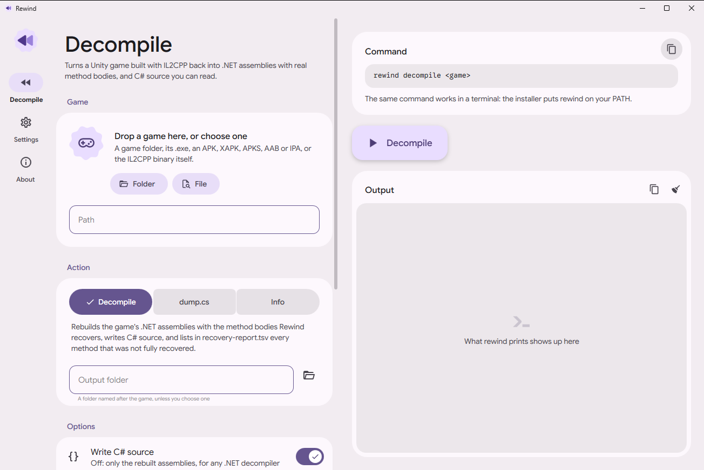

<p align="center">
  <picture>
    <source media="(prefers-color-scheme: dark)" srcset="assets/rewind-banner-dark.svg">
    
  </picture>
</p>

A decompiler for Unity games built with IL2CPP.

When Unity builds a game with IL2CPP, it converts the C# to C++, compiles that to native code, and throws the
original .NET assemblies away. All that ships is a native binary and a metadata file. Rewind works backwards
from those two files and gives you .NET assemblies with real method bodies, plus C# source you can read.

Plenty of tools can recover the types and method signatures. Rewind's goal is to recover what the methods
actually do as well.

<p align="center">
  <picture>
    <source media="(prefers-color-scheme: dark)" srcset="assets/screenshot-dark.png">
    
  </picture>
</p>

## Download

On Windows, get the installer from [Releases](https://github.com/ratman-bit/Rewind-IL2CPP-Decompiler/releases):

| Installer | Built from |
| --- | --- |
| `Rewind-main-Setup.exe`, in the newest release named `Rewind <version>` | the `main` branch: only work that passed the full test pass |
| `Rewind-experimental-Setup.exe`, in the newest release named `Rewind <version>-experimental` | the `experimental` branch: every change first, tested or not |

Once `main` has a release, the one marked "Latest" is always `main`'s newest.

It installs two things for your Windows account, with no administrator rights or .NET install needed:

- **the desktop app**, with a Start menu and desktop shortcut;
- **the `rewind` command**, put on your PATH so it works in any terminal you open afterwards.

The app keeps both up to date. It looks for a new build when it starts and every few hours, downloads it in the
background and installs it the next time it starts. In Settings you can switch which branch you update from
(switching installs that branch's newest build, even when it's older than yours) or turn automatic updates off.
Each release also has a `Portable.zip` that runs without installing, but doesn't update itself.

The installers aren't code-signed, so Windows SmartScreen may ask you to confirm the first time.

On Linux, each release also carries `Rewind-main-linux-x64.tar.gz` (or `Rewind-experimental-linux-x64.tar.gz`): a
self-contained `rewind` command with no .NET install needed, extracted anywhere and run from there. The desktop
app is WPF, so it is Windows-only; on Linux the command-line decompiler is the whole product.

## The desktop app

The app is a window over the `rewind` command: it runs the same `rewind.exe` and shows what it prints, so it gives
exactly the output the command does. You choose the game (or drop it onto the window), choose between decompile,
`dump.cs` and info, and set every option the command has. The app shows the command line it will run, so you can
copy it into a terminal. While Rewind works, the app shows how far it got; afterwards it shows how many method
bodies were recovered and gives you buttons for the output, the C# source and the recovery report. If a game isn't
standard IL2CPP, it says so.

It's built after Material 3 Expressive: its colors are made from one color you pick (or Windows' accent color)
with the same algorithm Android uses, in light, dark or following Windows.

## Before you start

Rewind only reads standard IL2CPP builds. If a game's metadata is encrypted or modified, or the game is
protected in some other way, Rewind tells you so and stops. It has no decryption, memory dumping or anti-cheat
bypass features, and that's on purpose.

## Building

You need the .NET 10 SDK.

```
dotnet build Rewind.slnx -c Release
```

The command-line tool ends up in `src/Rewind.Cli/bin/Release/net10.0/rewind.dll`, and you run it with
`dotnet`:

```
dotnet src/Rewind.Cli/bin/Release/net10.0/rewind.dll info path/to/game
```

Run it from the repo folder so it finds the signature libraries in `signatures/`, or point at a library or a
folder of them with `--signatures`.

The desktop app (Windows only) builds to `src/Rewind.Gui/bin/Release/net10.0-windows/Rewind.Gui.exe`. Run from
there, it uses the command-line tool built in the same clone; you can point it at another `rewind.exe` in
Settings.

To build the installer yourself, install Velopack's packaging tool once and run the script:

```
dotnet tool install -g vpk --version 1.2.161
powershell -ExecutionPolicy Bypass -File installer/pack.ps1
```

It publishes both programs for Windows x64 into one folder and packs it into `artifacts/installer/`. The
`main` or `experimental` channel follows the branch you're on, and the version is `installer/version.txt` followed
by the number of commits (for example `0.1.80`, or `0.1.80-experimental`). You don't need to do this to get a
release: the workflow in `.github/workflows/release.yml` runs the same script on every push to `main` and
`experimental`, and publishes the result as a GitHub release.

## Using it

There are three commands:

```
rewind info <input>                   what the input is and whether Rewind can read it
rewind dump <input> [-o <dir>]        writes dump.cs: every type and member, with addresses and offsets
rewind decompile <input> [-o <dir>]   rebuilds the assemblies and writes C# source
```

`<input>` can be the game folder, the game's `.exe`, an APK, XAPK, APKS or AAB, an IPA, or the IL2CPP binary
itself (`GameAssembly.dll`, `libil2cpp.so` or `UnityFramework`). Rewind finds the metadata and the binary on
its own.

Options:

| Option | What it does |
| --- | --- |
| `-o`, `--out <dir>` | where to write the output (default `./rewind-out`) |
| `--assembly <name>` | only decompile this assembly; repeat it for more than one |
| `--no-source` | write the rebuilt assemblies only, skip the C# |
| `--csharp <version>` | write source for an older C# version, for example `9` for a Unity 2021.2+ project |
| `--state-machines` | show iterators and async methods as the classes the compiler made of them, instead of `yield return` and `await` |
| `--signatures <path>` | the signature file or folder to use for recognizing runtime functions |
| `--threads <n>` | how many threads recover method bodies (default: one per processor, or the `REWIND_THREADS` environment variable). The output is the same for any number |
| `--metadata <file>`, `--binary <file>` | use these files instead of searching for them |
| `--abi <name>` | which Android ABI to use from a package (`arm64-v8a`, `armeabi-v7a`, `x86_64`, `x86`) |
| `--unity <version>` | the Unity version, if Rewind can't work it out (for example `2022.3.33f1`) |
| `-v`, `--verbose` | print more progress details |

Running `rewind` with no arguments prints the same list.

## What you get

`decompile` writes:

| Path | What's in it |
| --- | --- |
| `assemblies/` | one .NET assembly per original assembly, with every type, member and attribute, and the method bodies Rewind recovered |
| `src/<Assembly>/` | C# source, one file per top-level type |
| `recovery-report.tsv` | every method that wasn't fully recovered, and the reason |
| `recovery-evidence.jsonl` | one machine-readable row per selected method definition, including identity, body address, recovery status, diagnostics and native call observations |

When Rewind can't fully work out part of a method, it doesn't guess. That part shows up as a call to
`__Rewind.Opaque<T>("...")` or `__Rewind.Effect("...")`, and the method starts with a `__Rewind.Note("...")`
that says what's missing. That way the gaps are easy to spot.

The evidence ledger uses the original assembly-scoped metadata token and method index rather than a method name alone. A body RVA may differ from the definition address for shared generic bodies. Native ranges and their mapped-byte SHA-256 are reported only where a native function table supplies a range. `clean` means no reported recovery problem, not a verified equivalent implementation. Unidentified native call observations are collected during HIR construction; they need not survive optimization and do not constitute a complete call graph.

The ARM64 helper shape smoke test (`dotnet run --project tests/Arm64CompareExchangeShapeSmoke -c Release`) exercises an outlined compare-exchange wrapper and both atomic implementation paths, including rejected instruction mutations. Set `REWIND_NO_ARM64_COMPARE_EXCHANGE=1` for an A/B run without this discovery rule.

## How it works

Roughly, in order:

1. **Reading the files.** Rewind parses the native binary (PE, ELF or Mach-O) and `global-metadata.dat`
   (metadata versions 24 to 39). It finds IL2CPP's registration tables by their structure, because shipped
   builds have no symbols to look them up by.
2. **Rebuilding the types.** The whole type system is rebuilt as real .NET assemblies with Mono.Cecil.
3. **Recognizing runtime functions.** Game code calls into the IL2CPP runtime all the time, and none of those
   functions have names in a shipped build. Rewind identifies them with a signature library. It uses
   position-independent fingerprints (which follow calls into other functions only as far as needed to be
   unique), the binary's own exported API names, a similarity sketch for builds that differ slightly, and
   jump thunks.
4. **Lifting and cleaning up.** Each method's x64 or ARM64 machine code is lifted to SSA form, the same IR for
   both, and the calling convention (Win64 or AAPCS64) says where each argument and result is. Then Rewind removes the
   things IL2CPP added that weren't in the C#: metadata and class initialization, write barriers, and the
   null, bounds and cast checks that IL does implicitly. It also undoes some of the compiler's work on loops,
   like 64-bit copies of 32-bit variables, duplicated counters and pointers walking over arrays.
5. **Translating.** What's left becomes typed managed operations (fields, array elements, calls, allocations)
   checked against the type model. When several methods share one compiled body, Rewind picks the right one
   from the argument and receiver types.
6. **Writing C#.** The result is emitted as IL into the rebuilt assemblies, and ICSharpCode.Decompiler turns
   it into C#.

## How well it works

All of these numbers come from test games built specifically for checking Rewind. With those, the original C#
source, the IL, the generated C++ and the debug symbols are all there to compare against.

| What was checked | Result |
| --- | --- |
| Method addresses against debug symbols | 39,257 of 39,257 (Windows x64, v39), 34,680 of 34,680 (Android ARM64, v39), 10,229 of 10,229 (Android, v31.1) |
| Rebuilt assemblies against the originals | identical type, field and method tokens and signatures; 43,141 of 43,141 overrides; 133,358 of 133,358 attributes |
| Runtime function identification | no wrong identifications in 5 build configurations, including 2 the library wasn't built from |
| Behavior of recovered code | 176 of 187 comparable test methods behave exactly like the original on up to 60 inputs each |

The behavior check is `rewind-lab diff-exec`. It loads the original assembly and the rebuilt one side by side,
calls the same static methods with the same inputs, and compares the results, any exceptions and any changes
to the arguments.

### Unity versions

One test project was built for Windows x64 with six Unity versions, and each Release build was decompiled
with the signature library for its version. A body counts as complete when all of it was recovered, with no
gap marked.

| Unity version | Metadata | Method addresses against debug symbols | Complete bodies, the project's own assembly | Complete bodies, whole game |
| --- | --- | --- | --- | --- |
| 2020.3.49f1 | v27.1 | 106,376 of 106,376 | 506 of 514 (98.4%) | 90,820 of 95,857 (94.7%) |
| 2021.3.45f2 | v31 | 117,312 of 117,312 | 502 of 514 (97.7%) | 99,238 of 105,241 (94.3%) |
| 2022.3.62f3 | v31.1 | 125,112 of 125,112 | 504 of 516 (97.7%) | 106,369 of 112,687 (94.4%) |
| 6000.0.85f2 | v31.1 | 136,870 of 136,870 | 502 of 514 (97.7%) | 116,366 of 123,449 (94.3%) |
| 6000.2.9f1 | v31.1 | 138,340 of 138,340 | 504 of 516 (97.7%) | 117,690 of 124,794 (94.3%) |
| 6000.3.12f1 | v39 | 146,603 of 146,603 | 504 of 516 (97.7%) | 124,779 of 132,027 (94.5%) |

The whole game includes Unity's and .NET's own class libraries, which is most of the code.

The libraries for 2020.3 to 6000.2 were each built from the project's Release build, Master build and
Release build without incremental garbage collection, and, from 2021.3 on, a Release build optimized for
size. One more configuration of each version was kept out of its library and used to check it against the
debug symbols (a Master build optimized for size; for 2020.3, a Master build without incremental garbage
collection). The 6000.3.12f1 library is an earlier one, built from another project, so both of this
project's builds were new to it. None of the six libraries made a wrong identification on a build it wasn't
built from.

Bodies in those held-out builds are a different matter: Master builds recover far fewer. 61.0% to 63.7% of
the whole game is complete in the five Master builds optimized for size, and 75.7% in the 2020.3 one.

The behavior check gives the same picture on every version. On 6000.3.12f1, 157 of the project's 179
comparable methods behave exactly like the original, and the other versions are within three methods of
that (156 to 160 of 178 or 179). The methods that differ are mostly the same ones on every version. Some
return objects that are never equal between two runs (iterators, delegates) and some run into the time
limit. The rest are real differences: exception handling, generic code, async methods and a few array and
string methods.

Without a library for its own version, a game is read with whichever other library recognizes most of its
runtime. Taking each game's own library away left 68.9% of the 2020.3.49f1 game complete instead of 94.7%,
91.0% instead of 94.3% for 2021.3.45f2 and 92.8% instead of 94.4% for 2022.3.62f3. For the three Unity 6
versions it made no difference beyond one method.

### Android (ARM64)

The 6000.3.12f1 test project was also built for Android (ARM64, Release) and decompiled from its APK with the
library `unity-6000.3.12f1-android-arm64.sig`. That library was made from this same build's symbols, so these
numbers don't say how well it recognizes the runtime of other Android builds.

| What was checked | Android ARM64 | The same project for Windows x64 |
| --- | --- | --- |
| Complete bodies, the project's own assembly | 500 of 516 (96.9%) | 505 of 516 (97.9%) |
| Complete bodies, whole game | 123,493 of 130,615 (94.5%) | 126,678 of 132,027 (95.9%) |
| Behavior check: comparable methods that behave exactly like the original | 159 of 179 | 160 of 179 |

Most of what is left on ARM64 the x64 build has as well (fully shared generic code, code inlined from other
classes). On top of that come stack buffers handed around as pointers, small private copies of methods that refer
to nothing of their own (so nothing tells which method they copy), and calls whose object clang stopped passing
because the method never reads it.

## What it can't do yet

- ARM64 (Android) bodies come out a little less complete than x64 ones so far (the numbers are under "Android
  (ARM64)" above). On ARM64, some SIMD instructions and stack buffers handed around as pointers are marked as
  gaps. 32-bit ARM and x86 builds get complete types and signatures but placeholder bodies.
- Generic methods, and methods of generic types, are recovered from the code their instantiations over
  reference types share. A definition that is only compiled for value types still gets a placeholder body.
  Where the shared code doesn't say which instantiation a call is to, the call is marked as a gap.
- `try`/`catch`/`finally` blocks are rebuilt, but not always. When a value is kept in a register across a
  caught exception, or the end of a `catch` can't be found, the method is flagged.
- Structs copied in 8- or 16-byte pieces, and structs kept on the stack, often aren't resolved to their
  fields yet. In real games this is the most common kind of gap.
- Inlined code mostly isn't folded back into a call. Simple field accessors and trivial constructors are, but
  other code that was inlined from another class uses that class's private members directly.
- Signature libraries come with Rewind for the six Unity versions in the table above for Windows x64, and
  for 6000.3.12f1 for Android ARM64. A game built with another version is read with whichever library recognizes most of its runtime, and
  fewer bodies come out complete the further apart the versions are (the numbers are under the table). The
  best result needs a library built for the game's exact version (see below).
- A library used on another Unity version than its own can also get a function wrong. Each of the six
  libraries was tried on the other five versions' test games: 29 of the 30 pairings had no wrong
  identification, and one had a single wrong one (the 6000.3.12f1 library on the 2020.3.49f1 game).
- Builds made with the Master compiler configuration come out far worse than Release builds. Of the
  6000.2.9f1 test game's bodies, 62.3% are complete for a Master build, against 94.3% for a Release build
  and 91.8% for a Release build optimized for size.
- Code generated by Unity 2020.3 leaves a `finally` block by a number it keeps on the stack. In large
  methods with several `try` blocks Rewind often can't follow that, and those methods are marked as gaps.
- Metadata versions other than 27.1, 31, 31.1 and 39 are written from the format's history but haven't been
  tested. Unity 6.5 and later (metadata v104 and up) isn't supported. Mach-O input hasn't been tested either.

## Supporting another Unity version

Rewind works best with a signature library for the exact Unity version a game was built with. It comes with
libraries for 2020.3.49f1, 2021.3.45f2, 2022.3.62f3, 6000.0.85f2, 6000.2.9f1 and 6000.3.12f1 (Windows x64),
and for 6000.3.12f1 (Android ARM64). For any other version it tries every library it has, nearest version first, and uses the one that recognizes
the most kinds of runtime function. To make a library for another version:

1. Install that Unity version and build any project with IL2CPP for Windows x64. Keep the
   `<Game>_BackUpThisFolder_ButDontShipItWithYourGame` folder the build creates, because `GameAssembly.pdb`
   is in it.
2. Dump the PDB's public symbols to a `symbols.tsv`, one per line: the RVA in hex, `1` if it's a function or
   `0` if not, and the name, separated by tabs. (The script used for this, `pdbsyms.py`, isn't in this repo
   yet.)
3. Build the library:

```
rewind-lab sig-build signatures/unity-<version>-windows-x64.sig <build folder> symbols.tsv [<build2> <symbols2> ...]
```

You can put several build configurations of the same version into one library. The more you include, the
more games built with that version Rewind recognizes exactly.

For Android ARM64, build an APK with IL2CPP for ARM64 instead and use the unstripped library Unity leaves in
`Library/Bee/artifacts/Android/il2cppOutput/build/arm64-v8a/` (`libil2cpp.sym.so` or `libil2cpp.dbg.so`): dump
its ELF symbol table into the same `symbols.tsv` format and pass the APK as the build. Name the library
`unity-<version>-android-arm64.sig`.

`rewind-lab` is the development tool in `src/Rewind.Lab`. After building, it's at
`src/Rewind.Lab/bin/Release/net10.0/rewind-lab.dll`.

## What's in the repo

| Path | What's in it |
| --- | --- |
| `src/Rewind.Core` | binary and metadata readers, and the type model |
| `src/Rewind.Analysis` | the lifter, IR, cleanup passes, recovery to typed operations and signature matching |
| `src/Rewind.Output` | assembly rebuilding, IL emission, C# output and `dump.cs` |
| `src/Rewind.Cli` | the `rewind` command |
| `src/Rewind.Gui` | the desktop app (WPF): Material 3 Expressive controls, the updater, and Google Sans and Google Sans Code |
| `src/Rewind.Lab` | `rewind-lab`, commands for measuring things during development (`hir-stats`, `diff-exec`, `sig-apply` and more) |
| `installer/` | `pack.ps1`, which builds the installer, and the version number |
| `.github/workflows/` | the release workflow |
| `signatures/` | signature libraries |
| `assets/` | the logo and banner, in light and dark versions (SVG and PNG), the app icon and the screenshots |

The test games and their ground truth are kept separately and aren't included.

## License

Rewind is licensed under the [Apache License 2.0](LICENSE). You're free to use it, fork it and change it. If
you share it or a modified version, keep the [NOTICE](NOTICE) file so the original project gets credit, and
mark the files you changed.

The libraries and fonts Rewind is built with keep their own licenses; they're listed in
[THIRD-PARTY-NOTICES.md](THIRD-PARTY-NOTICES.md).

### Late ARM64 metadata GOT loads

On ELF ARM64, a GOT read may become constant only after SSA simplification, too late for the machine lifter's read-only folding. The recovery normalizer now recognizes such loads when a full aligned pointer lies in a non-executable read-only-after-load range and points to a known metadata slot. It reuses normal metadata-slot canonicalization instead of treating writable runtime metadata as a raw constant. The late pass is restricted to ARM64 ELF; arbitrary writable memory, unknown targets, imports and partial read-only ranges are rejected. `REWIND_NO_LATE_METADATA_GOT=1` disables the change for A/B testing. The synthetic safety-policy smoke test is `dotnet run --project tests/MetadataGotLoadSmoke -c Release`.

### ARM64 lane and unused-receiver recovery

The ARM64 decoder/lifter handles additional byte/element reversals, vector BIF, variable unsigned shifts (signed low-byte counts and out-of-range zeroing), modified ORR/BIC immediates, floating compare against zero, and fixed-point integer-to-float conversion. `tests/Arm64LaneSmoke/oracle.py` generates seeded synthetic Unicorn CPU reference cases; `dotnet run --project tests/Arm64LaneSmoke -c Release -- <cases.json>` checks the lifted SSA results bit-for-bit. Tests use the default FP environment and are instruction-level, not whole-method equivalence proofs.

For a nonvirtual, nongeneric, unambiguous direct same-type instance call whose receiver was eliminated by the native compiler, the narrow ARM64 receiver proof checks that every entry path overwrites incoming x0 before reading it or transferring control outside the body. It rejects unknown instructions, backward branches, pre-kill calls/returns and exceptional entries with catches. Only then can recovery reuse the current instance as the managed receiver. Other cases retain their diagnostic. Set `REWIND_NO_RECEIVER_PROOF=1` to disable this rule. Run `dotnet run --project tests/Arm64ReceiverProofSmoke -c Release` for positive and negative synthetic cases.

### Bounded literal lookup tables

Long string-pointer tables can exceed the linear choice depth/budget even when their native index is already proven bounded. On ARM64 ELF, use a balanced unsigned select tree for up to 128 entries only when the entire aligned pointer table is mapped, non-executable, read-only-after-load and every entry resolves to a mapped string-literal metadata slot. The original dominating unsigned bounds check remains in place. Other lookup tables retain the existing policy. The new rule is disabled with `REWIND_NO_BALANCED_LITERAL_TABLES=1`.

Run `dotnet run --project tests/LiteralLookupTableSmoke -c Release`: checks all table lengths 1..128, every valid index (8256 comparisons), insertion ordering and source locations, bounded depth and 15 rejection cases. Synthetic checks do not establish whole-program equivalence.

### Base-two exponentials and explicit ARM64 FP32 boundaries

Recognize the exact C runtime symbols exp2/exp2f as unary math helpers, lowering them to the managed Pow(2,x) counterpart with the existing precision-specific math-call policy. Cross-library rounding can differ; this is a numerical mapping, not a claim of identical libm implementations.

ARM64 single-precision arithmetic rounds after each instruction. The CLI evaluation stack can keep additional precision, particularly on Unity Mono when a computed float is subsequently widened to double. The IL writer now emits an explicit conv.r4 after typed FP32 add/sub/mul/div/rem results for ARM64. This preserves the intermediate precision boundary, not merely the final return type. Disable this rule with REWIND_NO_EXPLICIT_FP32_ROUNDING=1 for output A/B checks. Tests of recovered DLLs should include the actual target runtime (Unity Mono as well as desktop .NET), since a .NET-only execution test can miss this discrepancy. This does not implement native FP exception flags, fused operations, or all FPCR modes. An exported C# decompiler may simplify explicit conversions; separately validate source round trips.

### Source round-trip preservation

The C# decompiler can simplify a conv.r4 on an already-float expression, losing the explicit native rounding boundary in the next compiler's output. Source export now stages a temporary copy of the recovered assembly and adds an ordinary non-inlined single-precision Round call after each existing conv.r4. The generated __RewindPrecision.cs implements that boundary; keep it with the source in the same compilation assembly. The original emitted DLL is never changed. The helper's name is reserved in the staged assembly. The source copy is removed on completion.

Use `rewind source recovered.dll -o source-directory --csharp 9` to re-export without native recovery. `--source-type Namespace.Type` selects exact top-level types (repeatable). `--raw-closures` retains compiler-generated methods instead of attempting to reconstruct lambdas/local functions, which is useful when those methods otherwise disappear because references have not yet been recovered. `--no-source-fp32` disables the source boundary transformation for comparison. Use fresh output directories for A/B comparisons.

Synthetic structural regression: `dotnet run --project tests/SourceFloatBoundarySmoke -c Release` checks ordinary and consecutive conversions, original branch and exception-handler endpoints, helper implementation, original file hash, temporary cleanup, disabled/no-conversion paths and reserved-name collision rejection. Source recompile and target-runtime behavior must still be checked separately; this mechanism does not repair unrelated source cleanup, unresolved calls or all floating-point behavior. Keep one generated helper per compilation assembly (do not blindly combine several assemblies' helper files).

### Bounded static delegate choices

The ARM64 RELRO metadata-table recognizer also accepts proven non-generic static MethodDef slots. The HIR writer folds a closed return diamond only when all incoming paths assign the same single-use pointer local, all targets match the exact delegate Invoke signature, the receiver is null, no exceptional region is involved, and selecting the method has no side effects. It constructs one delegate at the selected leaf instead of returning a merged raw code pointer to a delegate constructor. Unproven cases remain as before. REWIND_NO_METHOD_SLOT_TABLES=1 and REWIND_NO_DELEGATE_CHOICE_FOLDING=1 disable the two rules independently. DelegateChoiceSmoke tests a valid diamond and 13 malformed or unsupported variants.

Source export keeps explicit delegate construction (UseImplicitMethodGroupConversion=false) to preserve C# 9 typing and allocation identity. ILSpy can also turn floating negation into subtraction from +0, which differs for signed zero. In the temporary source copy only, protect a neg immediately following conv.r4 if no branch or exception entry bypasses the conversion. The generated no-inline Negate(float) helper uses unary minus; other negations are deliberately left alone. REWIND_NO_SOURCE_NEGATION=1 disables this additional protection for A/B. SourceFloatBoundarySmoke covers proven/unproven negation, branch and EH boundaries. Original recovered DLLs remain unchanged.

### Constructor scheduling and terminal List.Add recovery

Recover a constructor in an instance constructor when one or more independent reads of the caller's own fields were scheduled after the new object's base constructor and before its final plain stores. Require an exact recovered constructor template, known argument bindings, distinct fresh object and caller receiver, no moved local dependencies and no calls or non-plain stores after a delayed read. Do not move arbitrary loads, or claim concurrency equivalence for arbitrary shared objects. Disable with REWIND_NO_SCHEDULED_CTOR_READS=1.

The native compiler also inlines List<T>.Add, including private version/size/items accesses and the AddWithResize slow path. Restore the public Add only for the exact terminal void diamond with matching reference-element List<T> identity, version increment, unsigned capacity check, matching array store and resize argument, no alternate entries, extra temporary uses or exception regions. This relies on normal valid BCL list invariants. Disable with REWIND_NO_LIST_APPEND_FOLDING=1. Run `dotnet run --project tests/FsmConstructionSmoke -c Release` for the positive and rejected HIR shapes (1+9 constructor scheduling and 1+10 list append). This does not replace all inlined BCL operations or certify all methods without diagnostics.

### Shared-continuation List.Add recovery

The exact BCL append diamond can also end in a common successor (including loop backedges), or in equivalent void exits. In addition to reference elements, the rule accepts exact Int32/UInt32 element types. It permits up to four intervening nonthrowing integer-local computations only if independent of the list, count and backing-array temporaries. Both fast and resize paths must consume the same typed item. The rule retains the previous fail-closed CFG, temporary and EH restrictions and assumes valid BCL list invariants; it does not reconstruct arbitrary value-type layouts or list operations. The added tests cover integer elements, common continuation, independent computation, mixed returns and rejection of distinct continuations, side effects and private-count dependencies. `REWIND_NO_LIST_APPEND_FOLDING=1` disables the rule.

### Color32 overlay and merged-local list recovery

The IL writer can recover a read of the inaccessible Color32.rgba word through its four public byte channels. This ARM64 rule requires the exact UnityEngine.CoreModule Color32 identity, non-generic explicit value-type layout, original four-byte instance size and matching recorded field offsets and types. Evaluate the color expression once into a local, then assemble the little-endian word with shifts/OR. Only reads are transformed; no access to unknown/private overlays, inferred layouts or unrelated fields is introduced. Disable with REWIND_NO_PUBLIC_COLOR32_OVERLAY=1. PublicOverlayReadSmoke exercises one accepted and sixteen rejected layouts, actual emitted IL over 2048 synthetic inputs, and provider evaluation counts. Original Color32 machine-code layout and actual target Unity types should be verified separately.

ListAppendFolding may use a merge local's declared HVar type when its expression annotation is absent. If an annotation exists it must agree with the declaration. This is not inference from a name or from the destination; the previous capacity-diamond and pure-computation requirements still apply. FsmConstructionSmoke adds accepted unannotated integer-local and rejected conflicting-type cases.

### Bounded SZARRAY interior-cursor recovery (ARM64)

When an exact paired induction loop maintains both an integer index and an
interior pointer into the same captured single-dimensional array, recover the
typed element receiver instead of an untyped byte offset. The rule requires
zero index initialization, the native array data offset, matching captured
length reads, unsigned entry and signed backedge bounds, unit index increment,
and the exact stride from the proven non-enum value-type element layout.
Only the single direct, nonvirtual, nongeneric, parameterless value-type
instance call and the cursor recurrence may use the pointer. Other escapes,
exception regions, additional CFG entries, ambiguous targets and unknown
layouts are rejected. Rebuild typed HIR after the SSA rewrite; keep the
original index loop and calls. This relies on valid managed SZARRAY invariants
and does not infer arbitrary interior pointers. Disable using
`REWIND_NO_ARRAY_CURSOR_RECOVERY=1`. FsmConstructionSmoke covers one positive
and seventeen negative synthetic shapes.
